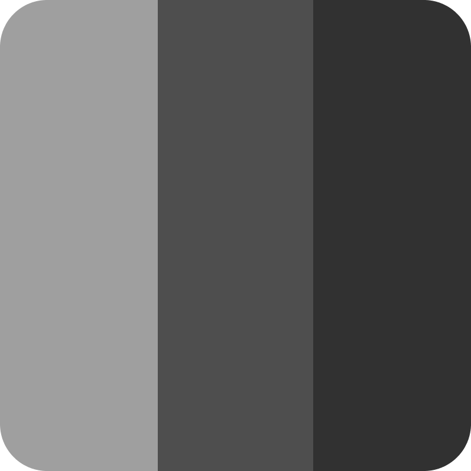

<!-- markdownlint-disable MD033 MD041 -->

# Presenter

<p align="center">
  
</p>

Aplicativo de apresentação de PDFs para desktop, construído com **Tauri 2** + **React** + **TypeScript**. Transforma um arquivo PDF em uma apresentação estilo PowerPoint, com uma janela de controle para o apresentador e janelas de projeção em tela cheia para o público.

## Recursos

- **Abertura de PDF** — selecione qualquer arquivo `.pdf` do computador, arraste e solte na tela inicial ou use o atalho `O`.
- **Histórico de arquivos** — sidebar na tela inicial exibe os últimos PDFs abertos; clique para reabrir (com verificação de existência e dialog de erro); menu com opções de abrir local do arquivo e remover do histórico.
- **Renderização em alta resolução** — cada página é desenhada em `<canvas>` via PDF.js (react-pdf), redimensionando-se automaticamente ao tamanho da janela.
- **Modo apresentador multi-janela** — a janela principal controla janelas `viewscreen-{idx}` exibidas em tela cheia nos monitores selecionados.
- **Modo tela cheia com monitor único** — quando há apenas um monitor, a janela principal entra em tela cheia com controles flutuantes.
- **Seleção multi-monitor** — marque múltiplos monitores para exibir a apresentação simultaneamente em várias telas (configuração persistida em disco).
- **Pré-carregamento** — as páginas anterior e posterior à atual são carregadas em segundo plano para transições instantâneas.
- **Preview do próximo slide** — miniatura da próxima página na sidebar direita, com tamanho redimensionável via arraste do mouse.
- **Carrossel de slides** — filmstrip na parte inferior com miniaturas de todas as páginas e anotações; clique para pular para qualquer slide; altura ajustável via arraste.
- **Zoom** — Ctrl+Scroll, `↑`/`↓` ou `Ctrl+`/`Ctrl−`/`Ctrl0` para ampliar/reduzir; Space+arraste para pan quando ampliado.
- **Cronômetro** — modo progressivo (stopwatch) ou regressivo (countdown) para controle de tempo (`F1` inicia/pausa, `F2` zera).
- **Tela preta** — oculta temporariamente o conteúdo do projetor (pausa visual).
- **Tela branca** — ilumina a tela do projetor, útil para perguntas da plateia (`W`, apenas durante a apresentação).
- **Exportar PDF** — gere uma cópia do documento com todas as anotações incorporadas.
- **Anotações ao vivo** — desenhe sobre os slides durante a apresentação com ferramentas sincronizadas em tempo real com o projetor:
  - **Caneta** — traço contínuo (cor e espessura ajustáveis; espessura via scroll do mouse).
  - **Marcador de texto** — destaque semi-transparente (cor e espessura ajustáveis).
  - **Laser** — ponteiro luminoso vermelho para chamar atenção.
  - **Borracha** — apague apenas os traços selecionados arrastando sobre eles (raio ajustável via scroll; duplo-clique apaga tudo na página).
  - **Desfazer / Refazer** — Ctrl+Z / Ctrl+Y para desfazer e refazer anotações (até 50 passos).
  - **Linhas retas** — segure Shift durante o arraste para travar o traço em ângulos de 45° (caneta e marcador).
- **Seleção de cores** — paleta de 6 cores preset com HexColorPicker para cores personalizadas; tamanhos e cores de caneta/marcador persistem entre execuções.
- **Botão de reset de tamanhos** — restaura os tamanhos e cores padrão das ferramentas de anotação.
- **Confirmação ao fechar** — impede fechamento acidental quando há PDF ou apresentação ativa.
- **Sidebar toggle** — sidebars podem ser ocultadas/mostradas via atalhos (`Z` e `X`).
- **Configurações** — dialog de configurações com seleção de cor de fundo do projetor (presets + hex personalizado), auto-hide dos controles flutuantes e timeout configurável.

## Atalhos de teclado

| Tecla | Ação |
| --- | --- |
| `F5` | Iniciar / Encerrar apresentação |
| `O` | Abrir PDF (tela inicial, sem documento aberto) |
| `→` / `Espaço` / `Page Down` | Próximo slide (`Espaço` só avança com zoom ≤ 1) |
| `←` / `Page Up` | Slide anterior |
| `Home` | Primeiro slide |
| `End` | Último slide |
| `B` | Alternar tela preta (durante a apresentação) |
| `W` | Alternar tela branca (durante a apresentação) |
| `Z` | Mostrar/ocultar sidebar esquerda |
| `X` | Mostrar/ocultar sidebar direita (preview) |
| `C` | Mostrar/ocultar carrossel |
| `F1` | Iniciar / pausar o cronômetro |
| `F2` | Zerar o cronômetro |
| `Esc` | Encerrar apresentação ou voltar ao início (com confirmação) |
| `L` | Ativar/desativar laser |
| `P` | Ativar/desativar caneta |
| `H` | Ativar/desativar marcador de texto |
| `E` | Ativar/desativar borracha |
| `Ctrl+Z` | Desfazer última anotação |
| `Ctrl+Y` | Refazer anotação |
| `↑` / `↓` | Zoom in / out |
| `Ctrl+=` / `Ctrl+-` | Zoom in / out |
| `Ctrl+0` | Resetar zoom |
| `Space+arraste` | Pan (quando zoom > 1) |
| `Scroll do mouse` (com ferramenta ativa) | Aumentar/diminuir tamanho da caneta, marcador ou borracha |
| `Duplo-clique` (com borracha) | Apagar todas as anotações do slide atual |

## Instalação

Há duas formas de usar o Presenter no Windows: **instalado** (instalador NSIS) ou **portátil** (uma pasta com o `presenter.exe`, sem instalação e sem escrita em `%APPDATA%`). Detalhes em [`docs/instalacao-windows.md`](docs/instalacao-windows.md).

Instalação em um único comando, sem baixar e abrir instaladores manualmente:

**Windows** (PowerShell):

```powershell
irm https://raw.githubusercontent.com/silv4b/presenter/develop/install.ps1 | iex
```

**Linux** (bash):

```sh
curl -fsSL https://raw.githubusercontent.com/silv4b/presenter/develop/install.sh | bash
```

Detalhes, opções e desinstalação em [`docs/instalacao-windows.md`](docs/instalacao-windows.md) e [`docs/instalacao-linux.md`](docs/instalacao-linux.md).

## Stack

- [Tauri 2](https://tauri.app/) — shell desktop (Rust)
- [React 19](https://react.dev/) + [TypeScript](https://www.typescriptlang.org/)
- [Vite](https://vite.dev/) — bundler
- [Tailwind CSS 4](https://tailwindcss.com/) + [shadcn/ui](https://ui.shadcn.com/) (Radix UI)
- [react-pdf](https://github.com/wojtekmaj/react-pdf) — renderização de PDF (PDF.js)
- [Lucide](https://lucide.dev/) — ícones

## Arquitetura

O projeto segue uma arquitetura inspirada em MVC com separação clara entre estado global, lógica de negócio, componentes de UI e backend Rust.

```text
presenter/
├── src/                           # Frontend React/TypeScript
│   ├── state/                     # Camada de estado global (Context API)
│   │   ├── annotations/           # Estado de anotações (provider + contexto compartilhado)
│   ├── components/                # UI Components
│   │   ├── sidebar/
│   │   └── ui/                    # Componentes base (shadcn/ui / Radix UI)
│   ├── viewscreen/                # Janela de projeção (instância secundária)
│   ├── hooks/                     # Hooks customizados
│   └── lib/                       # Helpers & utilitários
├── src-tauri/                     # Backend Rust
│   ├── src/
│   ├── capabilities/default.json  # Permissões janelas
│   ├── tauri.conf.json            # Config app + janelas
│   └── icons/                     # Ícones multi-resolução/plataforma
├── scripts/                       # Scripts de build (portable.js, release.js)
├── docs/                          # Documentação adicional
├── .github/workflows/             # CI/CD GitHub Actions
├── src/assets/                    # Assets estáticos
├── .vscode/
├── .gitignore
├── AGENTS.md                      # Diretrizes para agentes
├── install.ps1                    # Instalador automático (Windows)
├── install.sh                     # Instalador automático (Linux)
├── LICENSE
├── README.md
├── package.json
├── package-lock.json
├── tsconfig.json
├── tsconfig.node.json
├── vite.config.ts
└── components.json                # Config shadcn/ui
```

A separação clara entre `state/` (estado global), `components/` (UI), `hooks/` (lógica reutilizável), `lib/` (helpers puros) e `src-tauri/` (backend) facilita manutenção, testes e escalabilidade.

## Como executar

### Pré-requisitos

- [Node.js](https://nodejs.org/) (v20.19+ ou v22.12+, exigido pelo Vite 8) e npm
- [Rust](https://www.rust-lang.org/tools/install) (toolchain stable)
- Plataforma de build do Tauri — no Windows, o [Visual Studio Build Tools](https://visualstudio.microsoft.com/pt-br/visual-cpp-build-tools/) com a carga de trabalho "Desenvolvimento para desktop com C++" e o [WebView2 Runtime](https://developer.microsoft.com/microsoft-edge/webview2/) (normalmente já presente no Windows 10/11).

### Passos

1. **Clone e instale as dependências**

   ```sh
   npm install
   ```

2. **Execute em modo desenvolvimento**

   ```sh
   npm run tauri:dev
   ```

   Isso inicia o Vite (frontend em `http://localhost:1420`) e abre a janela do app com recarregamento automático.

3. **Gere o instalador de produção**

   ```sh
   npm run tauri:build
   ```

    Os artefatos são gerados em `src-tauri/target/release/bundle/` (`.exe` NSIS no Windows). O instalador NSIS usa um ícone personalizado configurado em `tauri.conf.json`. Para gerar também a **versão portátil** (pasta + zip, sem instalador), use `npm run tauri:portable`.

### Uso

1. Clique em **Abrir PDF** e selecione o arquivo da apresentação.
2. (Opcional) Na seção **Tela de projeção**, marque os monitores onde a apresentação será exibida.
3. Clique em **Iniciar (F5)** — as janelas de projeção abrem em tela cheia nos monitores selecionados.
4. Navegue com as setas, `Espaço` ou pelos controles da sidebar.
5. Use as ferramentas de anotação (caneta, marcador, laser, borracha) na barra inferior da sidebar.
6. Use `Z` e `X` para ocultar/mostrar as sidebars, `B` para tela preta e `F5`/`Esc` para encerrar.

## CI/CD

O projeto possui workflows automatizados no GitHub Actions:

- **`build-windows.yml`** — gera o instalador NSIS (`.exe`) e o pacote portátil no `windows-latest`
- **`build-linux.yml`** — gera pacotes `.deb` e `.AppImage` no `ubuntu-24.04`
- **`build-macos.yml`** — gera o instalador `.dmg` no `macos-latest` (ARM64)
- **`release.yml`** — disparado por tags `v*`, builda para todas as plataformas e publica o release no GitHub com os instaladores e o zip portátil

Os workflows `build-*.yml` rodam a cada push nas branches `main` e `develop`, e podem ser disparados manualmente (`workflow_dispatch`). O `release.yml` roda apenas quando uma tag `v*` é criada.

## Convenções de commit

As mensagens de commit seguem o padrão *semantic-release*, **escritas em português**, concisas e no imperativo, com um dos seguintes prefixos:

- `feat:` — novas funcionalidades
- `fix:` — correções de bugs
- `chore:` — manutenção (formatação, dependências, build)
- `ci:` — mudanças nos workflows do GitHub Actions
- `style:` — formatação sem mudança de comportamento
- `docs:` — documentação
- `refactor:` — refatorações sem mudança de comportamento
- `test:` — testes

Exemplo: `fix: corrige o zoom com Ctrl+scroll`. As diretrizes completas estão em [`AGENTS.md`](AGENTS.md).
